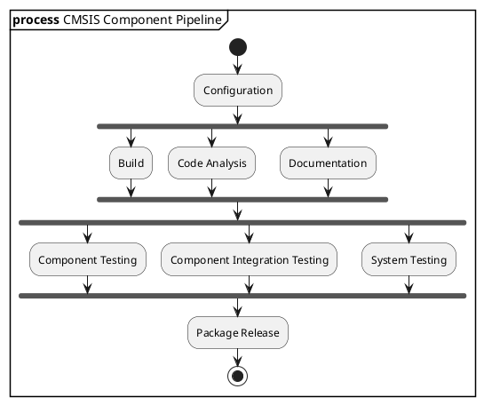

# Embedded Firmware Development & Personal Lab

## Introduction

This project aims to explore and establish a modern, AI-assisted embedded firmware development environment based on **CMSIS and CMSIS-Packs**, supported by a personal and portable computing infrastructure.

The goal is to build a reusable development ecosystem covering firmware engineering, development and testing environments, AI-assisted workflows, and personal infrastructure — from a centralized HomeLab to portable and autonomous development environments.

## Objectives

### Embedded Firmware Development

- Explore and evaluate the **CMSIS AI Developer Assistant**.
- Define standardized firmware development and test environments.
- Establish a consistent firmware development process and workflow.
- Define reusable project structures and development templates.
- Create documentation templates and development guidelines.

### AI Engineering & Agent Skills

- Explore AI Agent skills and their application to software engineering.
- Discover and evaluate relevant Claude Skills and other agent capabilities.
- Investigate how AI agents can assist with architecture, development, testing, debugging, security, and documentation.
- Establish reusable AI-assisted engineering workflows.

### Personal Lab Infrastructure

- Design and build a personal **HomeLab** for storage, services, administration, media, and development infrastructure.
- Establish a **DevOps Lab** for CI/CD, automated builds, firmware testing, and development services.
- Explore portable and autonomous computing environments through **MobileLab** (car / van / VanLife), **Personal Lab** (local development workstation), and **FootLab** (ultra-portable computing).
- Enable secure remote access, local development, offline operation, and synchronization between environments.

## CI/CD

### CMSIS Component Pipeline

## Configuration

 Prepare the development environment by defining the target platform, toolchain dependencies and build configuration.

Deliverables: Generate the Compilation Database (compile_commands.json).

Tools: 

##  Build 

Compile and link the source code using the configured toolchain and build settings.

Deliverables: Firmware binaries, object files and build reports.

Tools: 

## Code Analysis

**Objectives:**

**Deliverbles:**

**Tools:**

## Documentation

**Objectives:**

**Deliverbles:**

**Tools:**

## Component Testing

**Objectives:**

**Deliverbles:**

**Tools:**

## Component Integration Testing

**Objectives:**

**Deliverbles:**

**Tools:**

## System Testing

**Objectives:**

**Deliverbles:**

**Tools:**

## Package Release

**Objectives:**

**Deliverbles:**

**Tools:**