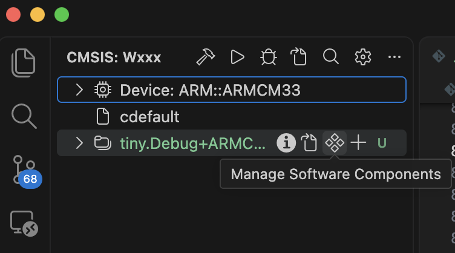
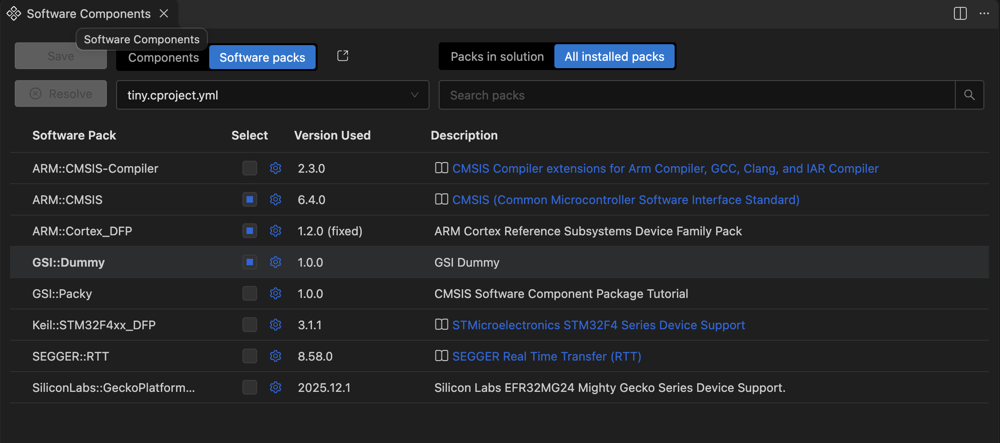
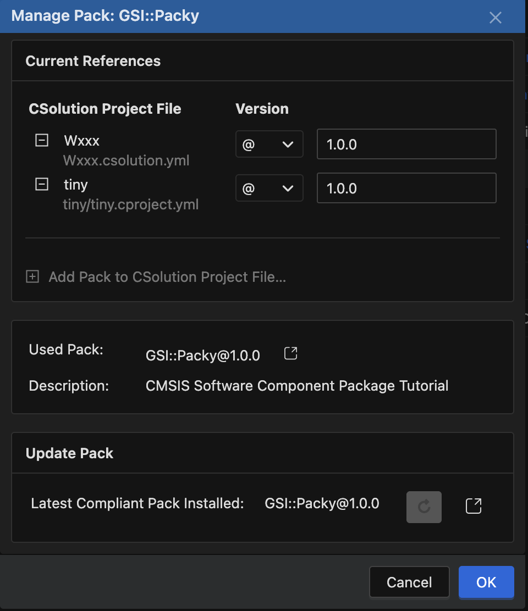
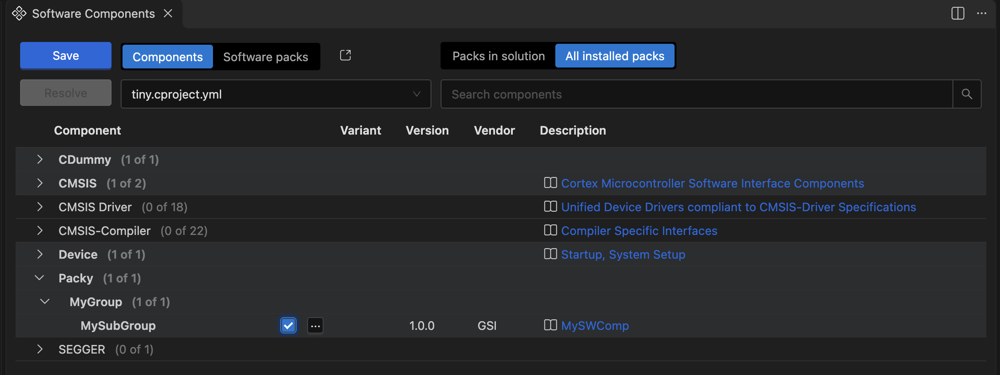

# Packy


## Version 1.0.0 - Empty CMSIS Software Component Package

*Create `GSI.Packy.pdsc` file*

```bash
touch GSI.Packy.pdsc
```
For this tutorial 
- the `Vendor` Name will be `GSI`,  
- the Package Name is `Packy`,
- the Package Description is `CMSIS Software Component Package Tutorial`

For the Version `1.0.0`
- the Release version is `1.0.0`with the comment `Initial Release`


Copy the followin contain to `GSI.Packy.pdsc`

```xml
<?xml version="1.0" encoding="utf-8"?>

<package schemaVersion="1.4" xmlns:xs="http://www.w3.org/2001/XMLSchema-instance" xs:noNamespaceSchemaLocation="PACK.xsd">
  <vendor>GSI</vendor>
  <name>Packy</name>
  <description>CMSIS Software Component Package Tutorial</description>
  <url></url>
  <supportContact></supportContact>
  <!-- optional license file -->
  <!-- 
  <license>
  </license>
  -->
  
  <releases>
    <release version="1.0.0">
    Initial Release
    </release>
  </releases>

  <keywords>
    <!-- keywords for indexing -->
    <keyword>GSI</keyword>
    <keyword>Packy</keyword>
  </keywords>
  <!-- apis section (optional - for Application Programming Interface descriptions) -->
  <!-- 
  <apis>
  </apis>
  -->

  <!-- boards section (mandatory for Board Support Packs) -->
  <!-- 
  <boards>
  </boards>
  -->

  <!-- devices section (mandatory for Device Family Packs) -->
  <!--
  <devices>
  </devices>
  -->

  <!-- examples section (optional for all Software Packs)-->
  <!--
  <examples>
  </examples>
  -->
  
  <!-- conditions section (optional for all Software Packs)-->
  <!--
  <conditions>
  </conditions>
  -->
  
  <!-- component section (optional for all Software Packs)-->
<components>
    <component Cclass="Packy" Cgroup="MyGroup" Csub="MySubGroup" Cversion="1.0.0">
      <description>MySWComp</description>
      <files>
        <file category="doc"    name="docs/Packy.html"/>
        <file category="header" name="source/Packy.h"/>
        <file category="header" name="source/config/Packy_Config.h" attr="config" version="1.0.0"/>
        <file category="source" name="source/Packy.c"/>
      </files>
    </component>
</components>

  
  
  <!-- optional taxonomy section for defining new component Class and Group names -->
  <!--
  <taxonomy>
  </taxonomy>
  -->
  
</package>

```

*Create a `pack.json`*

This file is a artefact use make the `packgen.sh` script more generic

```bash
touch pack.json
```

Copy the followin contain to `pack.json`
```json
{
	"PACK_VENDOR": "GSI",
	"PACK_NAME": "Packy",
	"PACK_DIRS": ["./docs","./source"],
	"PACK_BASE_FILES": ["./source/config/Packy_Config.h", "./source/Packy.h"],
	"PDSC_FILES": ["./GSI.Packy.pdsc"],
	"PACK_WAREHOUSE": "../Packs"
}
```

*Generate Package*

```bash
./packgen.sh pack.json
```


*Add the `GSI.Packy.1.0.0.pack`to TBD*

```bash
cpackget add --agree-embedded-license ../Packs/GSI.Packy.1.0.0.pack
```












## Version 1.1.0 - Add Conditions


Copy the followin contain to `GSI.Packy.pdsc`

```xml
<?xml version="1.0" encoding="utf-8"?>

<package schemaVersion="1.4" xmlns:xs="http://www.w3.org/2001/XMLSchema-instance" xs:noNamespaceSchemaLocation="PACK.xsd">
  <vendor>GSI</vendor>
  <name>Packy</name>
  <description>CMSIS Software Component Package Tutorial</description>
  <url></url>
  <supportContact></supportContact>
  <!-- optional license file -->
  <!-- 
  <license>
  </license>
  -->
  
  <releases>
    <release version="1.2.0" >
    Variants introduced
    </release>
    <release version="1.1.0" date="06-11-2027">>
    Conditions added
    </release>
    <release version="1.0.0" >
    Initial Release
    </release>
  </releases>

  <keywords>
    <!-- keywords for indexing -->
    <keyword>GSI</keyword>
    <keyword>Packy</keyword>
  </keywords>
  <!-- apis section (optional - for Application Programming Interface descriptions) -->
  <!-- 
  <apis>
  </apis>
  -->

  <!-- boards section (mandatory for Board Support Packs) -->
  <!-- 
  <boards>
  </boards>
  -->

  <!-- devices section (mandatory for Device Family Packs) -->
  <!--
  <devices>
  </devices>
  -->

  <!-- examples section (optional for all Software Packs)-->
  <!--
  <examples>
  </examples>
  -->
  
  <!-- conditions section (optional for all Software Packs)-->
<conditions> 
    <condition id="Arm Compiler">
        <require Tcompiler="ARMCC" Toptions="AC6"/>
    </condition>
    <condition id="CM0">
        <description>Cortex-M0 based device</description>
        <require condition="Arm Compiler"/>
        <accept  Dcore="Cortex-M0"/>
        <accept  Dcore="Cortex-M0+"/>
    </condition>
    <condition id="CM3">
        <description>Cortex-M3 based device</description>
        <require condition="Arm Compiler"/>
        <accept  Dcore="Cortex-M3"/>
    </condition>
    <condition id="ARMCM33">
        <description>Cortex-M33 based device</description>
        <require condition="Arm Compiler"/>
        <accept  Dcore="Cortex-M33"/>
    </condition>
    <condition id="CM4_CM7">
        <description>Cortex-M4 based device</description>
        <require condition="Arm Compiler"/>
        <accept  Dcore="Cortex-M4"/>
        <accept  Dcore="Cortex-M7"/>
    </condition>
    <condition id="CMSIS Core with RTOS2">
        <description>CMSIS Core with RTOS2 for Cortex-M processor</description>
        <accept  condition="CM0"/>
        <accept  condition="CM3"/>
        <accept  condition="CM4_CM7"/>
        <require Cclass="CMSIS" Cgroup="CORE"/>
        <require Cclass="CMSIS" Cgroup="RTOS2"/>
    </condition>
</conditions>
  
  <!-- component section (optional for all Software Packs)-->
<components>
    <component Cclass="Packy" Cgroup="MyGroup" Csub="MySubGroup" Cversion="1.0.0">
      <description>MySWComp</description>
      <files>
        <file category="doc"    name="docs/Packy.html"/>
        <file category="header" name="source/Packy.h"/>
        <file category="header" name="source/config/Packy_Config.h" attr="config" version="1.0.0"/>
        <file category="source" name="source/Packy.c"/>
      </files>
    </component>

    <component Cclass="Packy" Cgroup="MyGroup" Csub="MySubGroup" Cversion="1.1.0" condition="CM3">
      <description>MySWComp</description>
      <files>
        <file category="doc"    name="docs/Packy.html"/>
        <file category="header" name="source/Packy.h"/>
        <file category="header" name="source/config/Packy_Config.h" attr="config" version="1.1.0"/>
        <file category="source" name="source/Packy.c"/>
        <file category="library" condition="CM0"     name="libraries/packy_cm0.lib"/>
        <file category="library" condition="CM3"     name="libraries/packy_cm3.lib"/>
        <file category="library" condition="CM4_CM7" name="libraries/packy_cm4.lib"/>
      </files>
    </component>

    <component Cclass="Packy" Cgroup="MyGroup" Cvariant="Release" Cversion="1.2.0" condition="ARMCM33">
    <description>Release version of MyVariant</description>
    <RTE_Components_h>
    <!-- the following content goes into file 'RTE_Components.h' -->
    #define RTE_PACKY_RELEASE               /* MyVariant Release Version */
   </RTE_Components_h>
   <files>
        <file category="doc"    name="docs/Packy.html"/>
        <file category="header" name="source/Packy.h"/>
        <file category="header" name="source/config/Packy_Config.h" attr="config" version="1.1.0"/>
        <file category="source" name="source/Packy.c"/>
        <file category="library" condition="CM0"     name="libraries/packy_cm0.lib"/>
        <file category="library" condition="CM3"     name="libraries/packy_cm3.lib"/>
        <file category="library" condition="CM4_CM7" name="libraries/packy_cm4.lib"/>
  </files>
</component>

    <component Cclass="Packy" Cgroup="MyGroup" Cvariant="Debug" Cversion="1.2.0" condition="ARMCM33">
    <description>Release version of MyVariant</description>
    <RTE_Components_h>
    <!-- the following content goes into file 'RTE_Components.h' -->
    #define RTE_PACKY_DEBUG              /* MyVariant Release Version */
   </RTE_Components_h>
   <files>
        <file category="doc"    name="docs/Packy.html"/>
        <file category="header" name="source/Packy.h"/>
        <file category="header" name="source/config/Packy_Config.h" attr="config" version="1.1.0"/>
        <file category="source" name="source/Packy.c"/>
        <file category="library" condition="CM0"     name="libraries/packy_cm0.lib"/>
        <file category="library" condition="CM3"     name="libraries/packy_cm3.lib"/>
        <file category="library" condition="CM4_CM7" name="libraries/packy_cm4.lib"/>
  </files>
</component>

<component Cclass="Packy" Cgroup="MyGroup" Cvariant="Sources" Cversion="1.2.0" condition="ARMCM33">
    <description>Release version of MyVariant</description>
    <RTE_Components_h>
    <!-- the following content goes into file 'RTE_Components.h' -->
    #define RTE_PACKY             /* MyVariant Release Version */
   </RTE_Components_h>
   <files>
        <file category="doc"    name="docs/Packy.html"/>
        <file category="header" name="source/Packy.h"/>
        <file category="header" name="source/config/Packy_Config.h" attr="config" version="1.1.0"/>
        <file category="source" name="source/Packy.c"/>
        <file category="library" condition="CM0"     name="libraries/packy_cm0.lib"/>
        <file category="library" condition="CM3"     name="libraries/packy_cm3.lib"/>
        <file category="library" condition="CM4_CM7" name="libraries/packy_cm4.lib"/>
  </files>
</component>

</components>

  
  
  <!-- optional taxonomy section for defining new component Class and Group names -->
  <!--
  <taxonomy>
  </taxonomy>
  -->
  
</package>

```

Copy the followin contain to `pack.json`
```json
{
	"PACK_VENDOR": "GSI",
	"PACK_NAME": "Packy",
	"PACK_DIRS": ["./docs","./source","./libraries"],
	"PACK_BASE_FILES": ["./source/config/Packy_Config.h", "./source/Packy.h"],
	"PDSC_FILES": ["./GSI.Packy.pdsc"],
	"PACK_WAREHOUSE": "../Packs"
}
```
*Generate Package*

```bash
./packgen.sh pack.json
```

*Add the `GSI.Packy.1.1.0.pack`to TBD*

```bash
cpackget add --agree-embedded-license ../Packs/GSI.Packy.1.1.0.pack
```

## Version 1.2.0 - Add Variants

Copy the followin contain to `GSI.Packy.pdsc`

```xml
<?xml version="1.0" encoding="utf-8"?>

<package schemaVersion="1.4" xmlns:xs="http://www.w3.org/2001/XMLSchema-instance" xs:noNamespaceSchemaLocation="PACK.xsd">
  <vendor>GSI</vendor>
  <name>Packy</name>
  <description>CMSIS Software Component Package Tutorial</description>
  <url></url>
  <supportContact></supportContact>
  <!-- optional license file -->
  <!-- 
  <license>
  </license>
  -->
  
  <releases>
    <release version="1.1.0" date="2027-11-06">
    Conditions added
    </release>
    <release version="1.0.0">
    Initial Release
    </release>

  </releases>

  <keywords>
    <!-- keywords for indexing -->
    <keyword>GSI</keyword>
    <keyword>Packy</keyword>
  </keywords>
  <!-- apis section (optional - for Application Programming Interface descriptions) -->
  <!-- 
  <apis>
  </apis>
  -->

  <!-- boards section (mandatory for Board Support Packs) -->
  <!-- 
  <boards>
  </boards>
  -->

  <!-- devices section (mandatory for Device Family Packs) -->
  <!--
  <devices>
  </devices>
  -->

  <!-- examples section (optional for all Software Packs)-->
  <!--
  <examples>
  </examples>
  -->
  
  <!-- conditions section (optional for all Software Packs)-->
<conditions> 
    <condition id="Arm Compiler">
        <require Tcompiler="ARMCC" Toptions="AC6"/>
    </condition>
    <condition id="CM0">
        <description>Cortex-M0 based device</description>
        <require condition="Arm Compiler"/>
        <accept  Dcore="Cortex-M0"/>
        <accept  Dcore="Cortex-M0+"/>
    </condition>
    <condition id="CM3">
        <description>Cortex-M3 based device</description>
        <require condition="Arm Compiler"/>
        <accept  Dcore="Cortex-M3"/>
    </condition>
    <condition id="CM4_CM7">
        <description>Cortex-M4 based device</description>
        <require condition="Arm Compiler"/>
        <accept  Dcore="Cortex-M4"/>
        <accept  Dcore="Cortex-M7"/>
    </condition>
    <condition id="CMSIS Core with RTOS2">
        <description>CMSIS Core with RTOS2 for Cortex-M processor</description>
        <accept  condition="CM0"/>
        <accept  condition="CM3"/>
        <accept  condition="CM4_CM7"/>
        <require Cclass="CMSIS" Cgroup="CORE"/>
        <require Cclass="CMSIS" Cgroup="RTOS2"/>
    </condition>
</conditions>
  
  <!-- component section (optional for all Software Packs)-->
<components>
    <component Cclass="Packy" Cgroup="MyGroup" Csub="MySubGroup" Cversion="1.1.0" condition="CMSIS Core with RTOS2">
      <description>MySWComp</description>
      <files>
        <file category="doc"    name="docs/Packy.html"/>
        <file category="header" name="source/Packy.h"/>
        <file category="header" name="source/config/Packy_Config.h" attr="config" version="1.0.0"/>
        <file category="source" name="source/Packy.c"/>
        <file category="library" condition="CM0"     name="libraries/packy_cm0.lib"/>
        <file category="library" condition="CM3"     name="libraries/packy_cm3.lib"/>
        <file category="library" condition="CM4_CM7" name="libraries/packy_cm4.lib"/>
      </files>
    </component>
</components>

  
  
  <!-- optional taxonomy section for defining new component Class and Group names -->
  <!--
  <taxonomy>
  </taxonomy>
  -->
  
</package>
```

Copy the followin contain to `pack.json`

```json
{
	"PACK_VENDOR": "GSI",
	"PACK_NAME": "Packy",
	"PACK_DIRS": ["./docs","./source","./libraries"],
	"PACK_BASE_FILES": ["./source/config/Packy_Config.h", "./source/Packy.h"],
	"PDSC_FILES": ["./GSI.Packy.pdsc"],
	"PACK_WAREHOUSE": "../Packs"
}
```
*Generate Package*

```bash
./packgen.sh pack.json
```

*Add the `GSI.Packy.1.2.0.pack`to TBD*

```bash
cpackget add --agree-embedded-license ../Packs/GSI.Packy.1.1.0.pack
```
## Version 1.3.0 - Add Instances

*Add the `GSI.Packy.1.3.0.pack`to TBD*

```bash
cpackget add --agree-embedded-license ../Packs/GSI.Packy.1.3.0.pack
```

## Version 1.4.0 - Add APIs

*Add the `GSI.Packy.1.4.0.pack`to TBD*

```bash
cpackget add --agree-embedded-license ../Packs/GSI.Packy.1.4.0.pack
```

## Version 1.5.0 - Add Example_Projects

*Add the `GSI.Packy.1.5.0.pack`to TBD*

```bash
cpackget add --agree-embedded-license ../Packs/GSI.Packy.1.5.0.pack
```

# Boardy